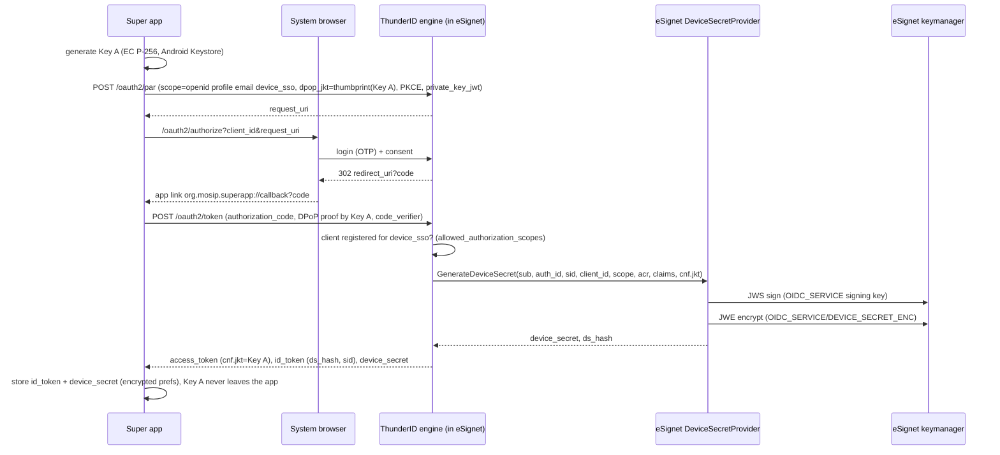
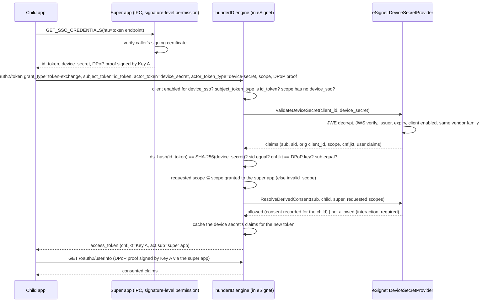

# Native SSO for Mobile Apps in eSignet (Go)
eSignet implements **OpenID Connect Native SSO for Mobile Apps 1.0** on top of its FAPI 2.0
authorization flow. A user who signs in once in a vendor's first native app (the *super app*) is
signed in silently in every other app of the same vendor on the same device (the *child apps*),
with no second OTP and no second consent screen, and without a shared browser session.

This document is the design reference for the feature: the protocol as eSignet implements it,
the split of responsibilities between eSignet and the embedded ThunderID engine, the API and
configuration changes, the security properties, and what a relying party has to do.

- Specification: [OpenID Connect Native SSO for Mobile Apps 1.0](https://openid.net/specs/openid-connect-native-sso-1_0.html)
- Token exchange: [RFC 8693](https://www.rfc-editor.org/rfc/rfc8693), DPoP: [RFC 9449](https://www.rfc-editor.org/rfc/rfc9449), PAR: [RFC 9126](https://www.rfc-editor.org/rfc/rfc9126)
- Reference apps and an end-to-end test: see the Postman collection in `postman-collection/` and the
  `mobile-sample/` Android apps that accompany this change.

## 1. Why

Native apps do not share cookies. Today every app of a vendor family repeats the full eSignet
login (UIN, OTP, consent). Native SSO replaces that with a cryptographically bound hand-off: the
super app receives a **device secret** next to its ID token; a sibling app presents both on a
**token exchange** and receives its own access token. The user sees one login, the server keeps
every token bound to one hardware key, and every claim the child app receives was consented to.

## 2. The flows

### 2.1 Super app: login with `device_sso`



What the ID token gains:

| Claim | Value |
|---|---|
| `ds_hash` | `BASE64URL(SHA-256(device_secret))`, binding this ID token to exactly one device secret |
| `sid` | The session id shared with the device secret. Without an SSO session store the authorization id is used. |

### 2.2 Child app: silent sign-in through token exchange



### 2.3 Bonus: re-consent in the child app

When the child app asks for a claim the user never released to the super app (for example the
child requests `email` and the user unticked `email` on the super app's consent screen), the
exchange answers:

```json
{"error":"interaction_required","error_description":"The consent granted to the originating application does not cover this request; claims not consented: email"}
```

The child app then runs an ordinary interactive authorization for its own client with
`prompt=consent`, and eSignet shows the consent screen. The same fallback handles `invalid_scope`
(the child asked for a scope the super app was never granted, mandatory task 10.a).

## 3. Where each task lives

| # | Mandatory task | Component | Where |
|---|---|---|---|
| 1 | `device_sso` scope on the authorize request | eSignet | `data/deployment.yaml` `allowed_scopes`; ThunderID treats it as a protocol scope (`SeparateOIDCAndNonOIDCScopes`) |
| 2 | Token endpoint validates the scope against the client | ThunderID + eSignet | `authorization_code.go` checks `oauthApp.Scopes`; `device_secret_provider.go` re-checks `allowed_authorization_scopes` |
| 3 | `DeviceSecretProvider` interface | ThunderID | `pkg/thunderidengine/providers/interface.go`, wired with `WithDeviceSecretProvider` |
| 4 | Generate / Validate device secret | eSignet | `internal/engine/device_secret_provider.go` |
| 5 | Token endpoint invokes generation | ThunderID | `authorization_code.go` |
| 6 | Response carries `access_token`, `id_token`, `device_secret` | ThunderID | `model.TokenResponse.DeviceSecret` |
| 7 | Child app fetches `id_token` + `device_secret` + DPoP proof from the super app | Mobile | `NativeSsoContract` (ContentProvider with a signature-level permission) |
| 8 | Child app calls token exchange, DPoP signed by Key A | Mobile | `EsignetClient.exchangeDeviceSecret` |
| 9 | Token exchange grant with `actor_token_type=device-secret`; validates the device secret, `ds_hash`, `sid`, client enablement, `cnf.jkt` | ThunderID | `token_exchange.go` `validateDeviceSecretActor` |
| 10a | Child scope ⊆ super app scope | ThunderID | `getScopes` with the device secret's scope as authority |
| 10b | `device_sso` rejected on token exchange | ThunderID | `ValidateGrant` |
| Bonus | Re-consent when consent does not cover the request | ThunderID + eSignet + Mobile | `DeviceSSOConsentProvider`, `ResolveDerivedConsent`, child app fallback |

## 4. The device secret

A device secret is a **signed-then-encrypted JWT**: eSignet signs the claims with its OIDC signing
key (`OIDC_SERVICE` / `MOSIP_ESIGNET_SIGNING_KEY_REF_ID`) and encrypts the JWS to a dedicated
Component Encryption Key `OIDC_SERVICE` / `DEVICE_SECRET_ENC` (RSA-OAEP-256 + A256GCM), provisioned
at startup. The apps only ever see the JWE, so the value is opaque to them; only eSignet can read
it back.

Signed claims:

| Claim | Meaning |
|---|---|
| `iss` | eSignet issuer; a secret from another server is refused |
| `sub` | the user (PSUT), must equal the ID token's `sub` on exchange |
| `auth_id` | the authorization the secret descends from |
| `sid` | session id, must equal the ID token's `sid` on exchange |
| `client_id` | the super app the secret was minted for; the exchange's actor (`act.sub`) |
| `scope` | what the super app was granted; the child may not exceed it |
| `acr` | the authentication context of the original login |
| `claims` | the user's attributes released to the super app, used to serve the child app's userinfo |
| `cnf.jkt` | thumbprint of Key A; the exchange must carry a DPoP proof from that key |
| `iat`, `exp`, `jti` | lifetime (default 30 days, bounded by `MOSIP_ESIGNET_DEVICE_SECRET_VALIDITY_SECONDS`) |
| `token_type` | `urn:openid:params:token-type:device-secret` |

The device secret is reusable: every sibling app can redeem it until it expires or the keys
rotate. Revocation of the family (sign-out) is a follow-up; see §8.

## 5. Vendor family and consent

- **Who may redeem a secret.** The presenting client must list `device_sso` in
  `additionalConfig.allowed_authorization_scopes` and must belong to the same relying party
  (`relyingPartyId`) as the super app, or be listed in the super app's
  `additionalConfig.allowed_child_clients`. Anything else is `invalid_grant` (vendor mismatch).
- **Scopes.** The child's scopes must be a subset of the scopes granted to the super app
  (`invalid_scope` otherwise), and `device_sso` itself is never exchangeable.
- **Consent is derived, never captured silently.** eSignet loads the super app's consent record
  for the user. The child's required claims (its registered claims released by the requested
  scopes) must all be among the claims the user accepted, and any authorization scope must have been
  permitted. If so, eSignet writes a consent record for the child app (so a later browser login of
  the child skips the prompt) with an audit row in `consent_history`; if not, the exchange answers
  `interaction_required`.

## 6. API changes

### Token endpoint, authorization code grant

Request: unchanged, except that the authorization request carried `scope=... device_sso`.

Response gains `device_secret` and the ID token gains `ds_hash` and `sid`:

```json
{
  "access_token": "eyJ...",
  "token_type": "DPoP",
  "expires_in": 120,
  "scope": "openid profile email device_sso",
  "id_token": "eyJ...",
  "device_secret": "eyJhbGciOiJSU0EtT0FFUC0yNTYi..."
}
```

### Token endpoint, token exchange grant

```
POST /oauth2/token
Content-Type: application/x-www-form-urlencoded
DPoP: <proof signed by Key A for POST {token_endpoint}>

grant_type=urn:ietf:params:oauth:grant-type:token-exchange
&audience=<issuer, exactly as in the discovery document>
&client_id=<child client>
&subject_token=<id_token of the super app>
&subject_token_type=urn:ietf:params:oauth:token-type:id_token
&actor_token=<device_secret>
&actor_token_type=urn:openid:params:token-type:device-secret
&scope=openid profile
&client_assertion_type=urn:ietf:params:oauth:client-assertion-type:jwt-bearer
&client_assertion=<PS256 private_key_jwt, aud = issuer>
```

Response: an access token bound to Key A whose `act.sub` is the super app's client id; no
`id_token` and never a `device_secret`.

Errors:

| Error | When |
|---|---|
| `invalid_request` | subject_token_type is not `id_token`, the subject token is not a self-issued ID token, or actor/subject tokens are missing |
| `unauthorized_client` | the presenting client is not registered for `device_sso` |
| `invalid_grant` | device secret cannot be decrypted/verified, expired, foreign issuer, vendor mismatch, `ds_hash`/`sid`/`sub` mismatch, DPoP key differs from `cnf.jkt` |
| `invalid_dpop_proof` | no DPoP proof although the secret is key-bound |
| `invalid_scope` | child scope exceeds the super app's grant, or `device_sso` was requested |
| `interaction_required` | the originating consent does not cover the request (re-consent) |

### Discovery

`grant_types_supported` lists the token exchange grant and `scopes_supported` lists `device_sso`.

### Client management

`grantTypes` accepts `"token_exchange"` next to `"authorization_code"`. Clients opt into Native SSO
with `additionalConfig.allowed_authorization_scopes: ["device_sso"]`; a super app may name
sibling clients of another relying party in `additionalConfig.allowed_child_clients`.

## 7. Configuration

| Setting | Default | Meaning |
|---|---|---|
| `MOSIP_ESIGNET_DEVICE_SECRET_VALIDITY_SECONDS` | 2592000 (30 days) | upper bound of a device secret's lifetime |
| `oauth.allowed_grant_types` (deployment.yaml) | includes `urn:ietf:params:oauth:grant-type:token-exchange` | enables the grant |
| `oauth.allowed_scopes` | includes `device_sso` | advertised in discovery |
| keymanager | `OIDC_SERVICE` / `DEVICE_SECRET_ENC` | encryption key, provisioned at startup |

## 8. Security notes and limits

- **Expired ID tokens are fine, expired device secrets are not.** eSignet ID tokens live minutes while
  a device secret lives up to 30 days, so the exchange validates the ID token's signature, issuer,
  `nbf` and revocation status but tolerates a past `exp` (Native SSO 1.0 §6.3); the device secret's
  `exp` bounds the exchange.
- **Key binding.** The code, the super app's tokens, the device secret and the child's token are all
  bound to Key A through `dpop_jkt`/`cnf.jkt`. A stolen `id_token + device_secret` pair is useless
  without the hardware key, and the child app never holds that key: the super app signs each proof.
- **App-to-app trust.** On Android the IPC is guarded by a `signature`-level permission and the
  super app re-checks the caller's certificate; only apps signed with the vendor's key can ask.
- **Opaque secret.** The JWE hides `sub`, `sid` and the claim snapshot from the apps and from
  anyone who reads app storage.
- **Consent.** Nothing is released to the child that the user did not accept for the super app.
- **Claims in the secret: mock identity only.** With the mock identity system the KYC token is a
  signed JWS and its claims are unpacked into the secret, so the child's `userinfo` is complete.
  With MOSIP IDA the KYC token is encrypted to the relying party's key; eSignet cannot unpack it and
  the exchange does not forward it, so the child's `userinfo` would be empty. Carrying the encrypted
  KYC token in the secret for same-relying-party children is the follow-up for a production deployment.
- **Not yet covered.** Single-use `jti` tracking and revoking a device secret on super-app
  sign-out are natural follow-ups (the `jti` is signed and available to a revocation store).

## 9. Relying party checklist

1. Register the super app and each child app under one `relyingPartyId`, each with
   `allowed_authorization_scopes: ["device_sso"]`, `require_pushed_authorization_requests`,
   `dpop_bound_access_tokens` and `require_pkce`; child apps add the `token_exchange` grant.
2. Sign all apps with one certificate; declare a `signature`-level permission in the super app and
   request it in the child apps (see `mobile-sample/`).
3. Super app: PAR + PKCE + DPoP login with `scope` including `device_sso`; keep `id_token` and
   `device_secret` in encrypted storage; expose them and DPoP signing over IPC.
4. Child app: fetch the credentials and a DPoP proof over IPC, call the token exchange, call
   userinfo with DPoP proofs from the super app; on `interaction_required` or `invalid_scope` fall
   back to an interactive authorization with `prompt=consent`.

## 10. Spec-conformance matrix

Status against OpenID Connect Native SSO for Mobile Apps 1.0 (draft 07), RFC 8693 and RFC 9449 as
implemented on the branches in this submission. "Deviation" entries are deliberate and explained.

| Requirement | Section | Status | Notes |
|---|---|---|---|
| `device_sso` scope requested on the authorization request | Native SSO §3.1 | implemented | protocol scope in ThunderID; the client must list it in `allowed_authorization_scopes` (PS task 2) |
| `device_secret` returned with the token response when `device_sso` was granted | §3.3 | implemented | signed-then-encrypted JWE, 30 days by default |
| `device_secret` and `id_token` issued together or not at all | §3.4 | implemented | `device_sso` without `openid` is refused with `invalid_scope` |
| `ds_hash` in the ID token = BASE64URL(SHA-256(device_secret)) | §3.5 | implemented | checked on every exchange |
| `sid` in the ID token, shared with the device secret | §3.5 | implemented | SSO session id, or the authorization id when no session exists |
| Exchange: `subject_token_type = id_token`, `actor_token_type = device-secret` | §4.1 | implemented | any other combination is `invalid_request` |
| Exchange: `audience` REQUIRED and equal to the issuer | §4.1 | implemented | missing → `invalid_request`, mismatch → `invalid_target` |
| Refresh-token grant keeps or re-issues the device secret while `device_sso` stays in scope; refreshed ID token carries `ds_hash` and `sid` | §3.3, §3.4.3 | implemented | A valid `device_secret` presented on the refresh request (same subject, client and DPoP key) is kept; a missing or invalid one is replaced |
| Exchange: `scope`, when present, includes `openid`; ⊆ the originally granted scope | §4.1, PS 10.a | implemented | Also ⊆ the child client's registered scopes: an unregistered scope is `invalid_scope`, and an omitted `scope` inherits only the registered subset. `device_sso` is refused explicitly and never inherited (PS 10.b) |
| Exchange: validate the ID token's signature and `sub`; expiry may be ignored | §4.3, §6.3 | implemented | signature, issuer, `nbf`, `typ` and revocation are still enforced |
| Exchange: validate the device secret and its binding (`ds_hash`, `sid`, `sub`) | §4.3 | implemented | plus vendor family and client enablement |
| Exchange: `sid` refers to a live session | §4.3 | deviation | equality is checked; session liveness is not tracked by the embedded engine. The device secret's own `exp` bounds the exchange. Marked out of scope in the PS. |
| Exchange: key binding of the device secret (`cnf.jkt`) to the DPoP proof | §4.3, RFC 9449 | implemented | `device_sso` without a DPoP proof is refused; a secret without `cnf.jkt` is never issued and would be refused |
| Exchange response: access token; `issued_token_type` | §4.4, RFC 8693 §2.2 | implemented | `token_type` is `DPoP` (RFC 9449 §5) rather than `bearer` because every token is key-bound |
| Exchange response: ID token for the child client (SHOULD) | §4.4 | not covered | the child reads identity through `userinfo`; adding a child ID token is a follow-up |
| Exchange response: new `device_secret` (MAY) | §4.4 | deviation (deliberate) | never issued on an exchange; a child app cannot become a super app |
| `act` claim naming the super app | RFC 8693 §4.1 | implemented | `act.sub` = super app client id |
| Discovery: `native_sso_supported: true` | §5 | implemented | present when a device-secret provider is configured |
| Device secret rotation / revocation on sign-out | §6 | not covered | `jti` is signed and available to a revocation store; no store is wired yet |
| Single-use `jti` | PS sequence diagram | not covered | secrets are reusable by design for repeated silent sign-ins; a deployment can add a used-`jti` cache |
| DPoP proof `htu`/`htm`/`ath`/`iat`/`jti` checks | RFC 9449 §4.3 | implemented (engine) | unchanged ThunderID DPoP validation |

## 11. Threat model and demo-only shortcuts

Assets: the device secret (30-day sign-in capability), Key A, the super app's tokens, the user's
consent decisions. Adversaries: another app on the phone, a thief with a copy of app storage, a
rogue relying party, a network attacker.

| Threat | Control | Residual risk |
|---|---|---|
| Another app reads the device secret from storage | EncryptedSharedPreferences; the secret is opaque (JWE) and useless without Key A | a rooted device exposes storage; the secret is still key-bound |
| A foreign app calls the Wallet's IPC | `signature`-level permission plus a certificate re-check on every call | the certificate is the trust anchor (see shortcuts) |
| Stolen `id_token + device_secret` pair replayed from another device | `cnf.jkt` must equal the DPoP proof key; Key A is non-exportable | none for the exchange; a stolen bearer token of 120 s remains usable until it expires |
| Child widens what the user consented to | scope ⊆ grant, derived consent, `interaction_required` | derived consent currently writes a consent row per child; it never narrows an existing richer consent |
| Rogue relying party redeems another vendor's secret | vendor family (`relyingPartyId` or `allowed_child_clients`) | cross-RP children share the pairwise subject of the super app's RP; restrict `allowed_child_clients` to one RP in deployments with pairwise subjects |
| Network attacker | TLS in deployment; DPoP binds tokens to Key A | the demo runs cleartext over `adb reverse` |
| Secret outlives the user's intent | 30-day expiry (configurable) | no revocation on super-app sign-out yet (§10) |

Demo-only shortcuts, listed so that nobody mistakes them for the design:

- The vendor signing keystore and its password are committed (`mobile-sample/keystore/`) so judges
  can build apps that pass the signature permission. A real vendor keeps its keystore private.
- Client private keys are generated by `register_clients.py` and shipped as APK resources; a real app
  generates them in the Keystore or uses attestation-based registration.
- Key A is an Android Keystore EC P-256 key; StrongBox is not requested and key attestation is not
  verified by eSignet.
- The SDK verifies the ID token's `nonce` but not its signature (the exchange is server-validated);
  a production SDK validates the JWS against the JWKS.
- The Wallet's `SIGN_DPOP` IPC only signs proofs for eSignet's PAR, token and userinfo endpoints
  (a sibling cannot use Key A as a general signing oracle).
- Cleartext HTTP is permitted in the apps' network security configuration for `localhost`.
- The mock identity system's KYC token is a signed JWS; with MOSIP IDA the KYC token is encrypted to
  the relying party and the child's `userinfo` would be empty (§8).
